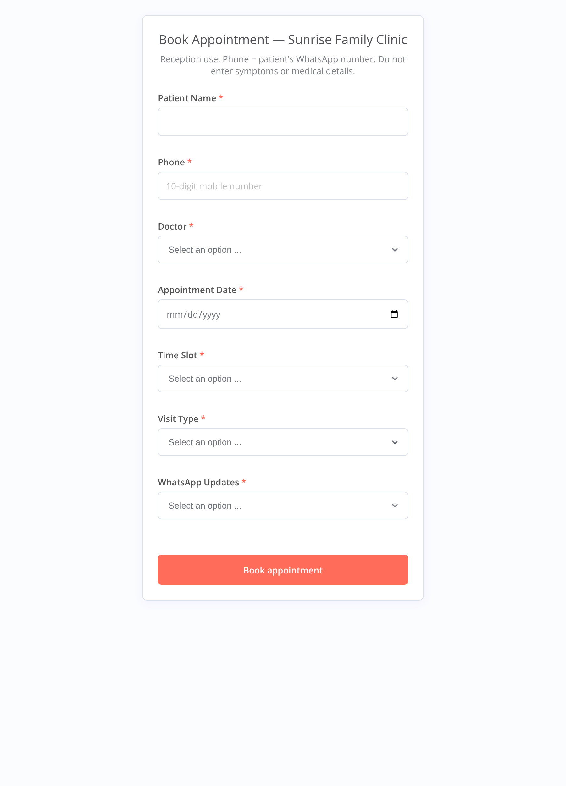
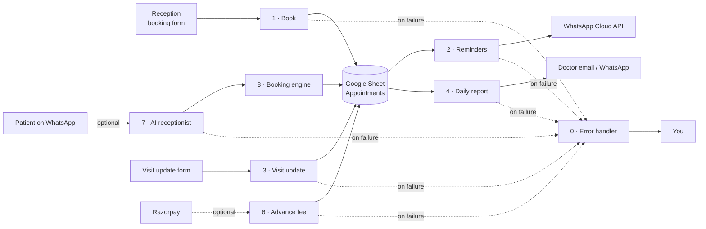

# Clinic Automation Kit (n8n)

A **reusable, tested base** for selling clinic automation to any clinic. You fill in one config file
per client, run one command, and get ready-to-import (or auto-deployed) n8n workflows for:

| # | Workflow | What the clinic gets |
|---|---|---|
| 1 | **Book Appointment** | Reception form → validates → blocks double booking → saves to Google Sheet → shows the Appointment ID (or why not + nearest free slots) |
| 2 | **WhatsApp Reminders** | Evening reminder for tomorrow's appointments + follow-up reminders (skipped if patient already re-booked). Failed numbers emailed to you |
| 2b | Same-day reminder *(optional)* | "Your appointment is in 2 hours" |
| 3 | **Visit Update** | Completed / No-show / Cancelled, payment, follow-up date (auto-moved off closed days) |
| 4 | **Daily Report** | Doctor's end-of-day email (optional WhatsApp): visits, no-shows, collection, pending payments, tomorrow — counts only, no patient names |
| 0 | **Error Handler** | Any failure anywhere → email to you |
| 6 | Razorpay advance fee *(optional)* | `payment_link.paid` → row marked Paid (signature verified) |
| 7+8 | WhatsApp **AI receptionist** *(optional add-on)* | Patients book / check / cancel on WhatsApp in their language. The AI only talks — availability and booking go through a deterministic engine with the same rules as the reception form |

Built from the two blueprints in this project (the ScaleRevenue.ai n8n Clinic Automation guide and the
WhatsApp + AI appointment workflow), hardened for repeat delivery.



## How it works



- **Google Sheet = the single source of truth** (one per clinic, owned by the clinic).
- **One logic library** (`src/lib/`) is compiled into every n8n Code node, so the form, the reminders and the AI all follow exactly the same rules — and those rules have unit tests.
- **One config file per client** (`clients/<slug>/client.config.json`) holds doctors, timings, holidays, templates, emails and feature switches. No secrets in it.

## Deliver to a new client (the short version)

```bash
npm run new-client -- city-dental "City Dental Care"
```
Fill `clients/city-dental/client.config.json` (every `REPLACE_` value), then:
```bash
npm run build -- city-dental
```
```bash
N8N_URL=https://citydental.app.n8n.cloud N8N_API_KEY=xxxx npm run deploy -- city-dental --activate
```

`deploy` creates (or, next time, updates) every workflow, links the error handler and AI tools,
attaches credentials by name, activates them and prints the form URLs. Prefer clicking? Import the files in
`dist/<slug>/workflows/` in n8n and follow `dist/<slug>/SETUP-CHECKLIST.md`.

The full step-by-step (discovery call → Meta setup → go-live → handover) is in
**[docs/02-delivery-playbook.md](docs/02-delivery-playbook.md)**.

## Commands

| Command | Does |
|---|---|
| `npm run new-client -- <slug> "Name"` | Create `clients/<slug>/client.config.json` from the template |
| `npm run build -- <slug>` / `npm run build:all` | Validate config, generate `dist/<slug>/` (workflows, checklist, WhatsApp template texts, sheet header) |
| `npm run deploy -- <slug> [--activate] [--dry-run]` | Create/update workflows in the client's n8n via the Public API (needs `N8N_URL`, `N8N_API_KEY`) |
| `npm test` | Unit + build tests (no n8n needed) |
| `npm run validate:n8n -- <slug>` | Check generated workflows against a real n8n install's node definitions (`N8N_MODULES=…`) |
| `npm run test:e2e` | Run the generated workflows inside a real local n8n with mocked Google/WhatsApp/Gmail (`N8N_MODULES=…`, `N8N_NODE=` Node 24) |

No `npm install` is needed — the kit has zero dependencies (Node ≥ 22).

## Repository layout

```
clients/_template/        config template (copy per client; real clients are git-ignored)
clients/demo-clinic/      worked example with every feature on
dist/demo-clinic/         pre-built demo — import these to see the system without building
src/lib/                  business logic (dates, phone, schedule, booking, reminders, visit, report, whatsapp, razorpay, AI engine)
src/workflows/            builders that turn config + lib into n8n workflow JSON
scripts/                  build, deploy, new-client, config validation, n8n validator, dev/e2e harness
sheet-template/           sheet headers, sample rows, Dashboard formulas
whatsapp-templates/       template bodies (English + Hinglish) to submit to Meta
docs/                     playbook, setup, testing, sales kit, handover, troubleshooting, AI add-on, developer guide
tests/                    node:test suites
```

## How it was verified

- `npm test` — 27 tests: booking rules, double booking, closed days/holidays, phone/date cleanup, reminder selection and dedupe, visit/payment logic, report numbers, WhatsApp payloads, Razorpay parsing, AI engine scoping, config validation, build output, deploy helpers.
- `validate:n8n` — all 9 demo workflows pass n8n 2.48's own parameter/version checks.
- `test:e2e` — 16 scenarios executed in real n8n 2.48 (booking success / empty sheet / clash / bad input, reminders incl. a failing number, visit update, report, error handler, Razorpay real HMAC good + forged, AI engine book + availability, Meta webhook verification, non-text messages).
- `deploy` was run against a live local n8n: create → re-deploy (update, credentials kept) → activate; the live form and the Meta verification webhook responded correctly.

Not verified here (needs real accounts): sending through a real WhatsApp number, real Google Sheets/Gmail OAuth, and live LLM conversations. Do those on the client's test number during go-live (`docs/04-testing-checklist.md`).

## Docs

1. [Architecture & design decisions](docs/01-architecture.md)
2. [Delivery playbook — new client, step by step](docs/02-delivery-playbook.md)
3. [Accounts & credentials (n8n, Google, Meta WhatsApp, Razorpay, OpenAI/Anthropic)](docs/03-accounts-and-credentials.md)
4. [Go-live testing checklist](docs/04-testing-checklist.md)
5. [Sales kit — pitch, demo, pricing, proposal](docs/05-sales-kit.md)
6. [Reception handover guide (give to the clinic)](docs/06-reception-handover.md)
7. [Troubleshooting](docs/07-troubleshooting.md)
8. [WhatsApp AI receptionist add-on](docs/08-ai-receptionist.md)
9. [Developer guide — extending the kit](docs/09-developer-guide.md)

> This system handles **appointments and admin only — never medical records.** No diagnosis, symptoms,
> prescriptions or reports in the sheet, messages or AI chat. Accounts and data belong to the clinic.
